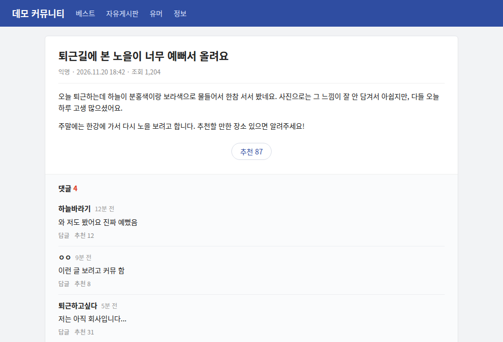
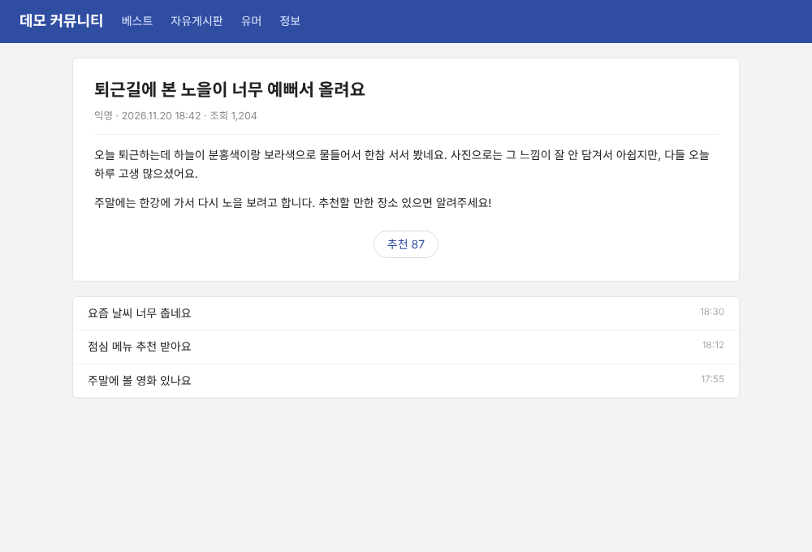
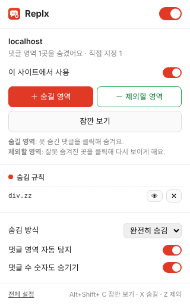
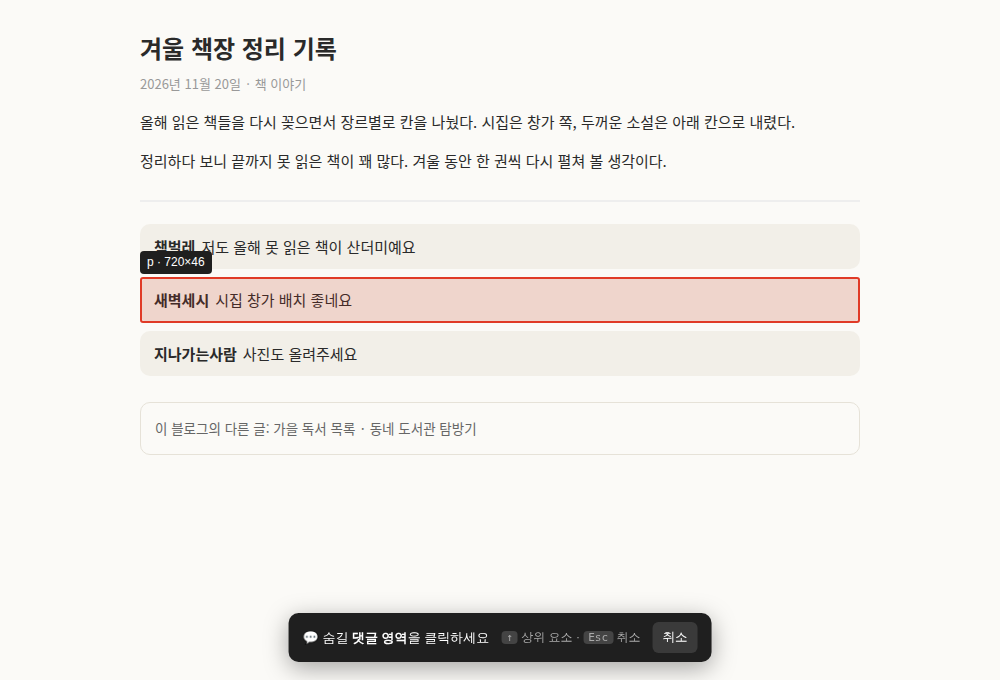
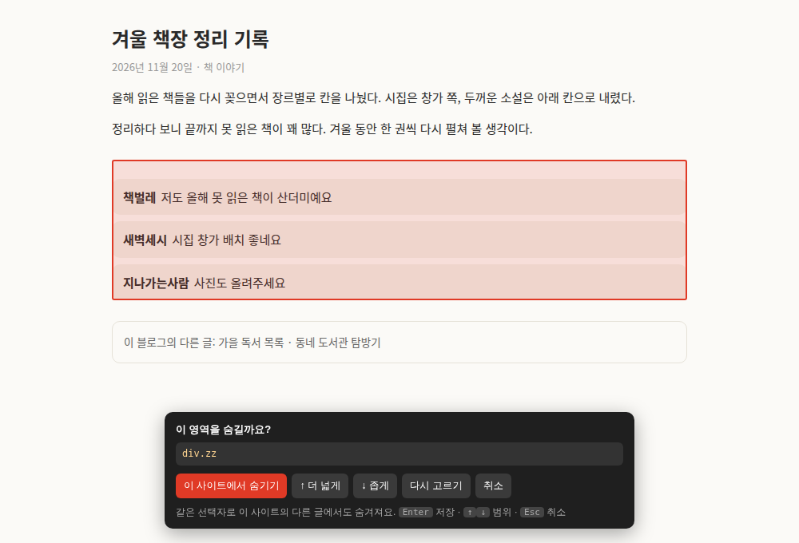
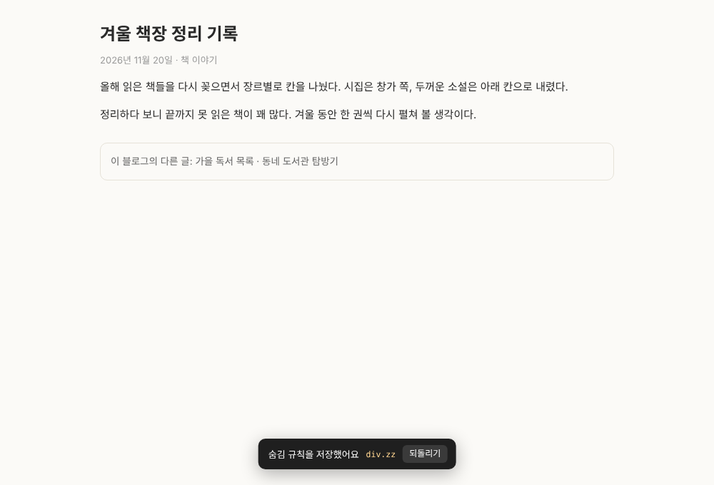
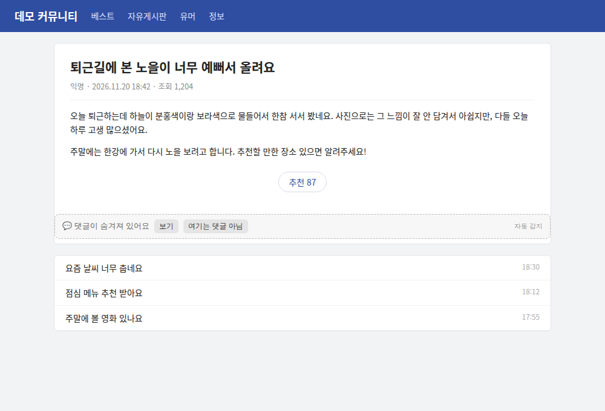
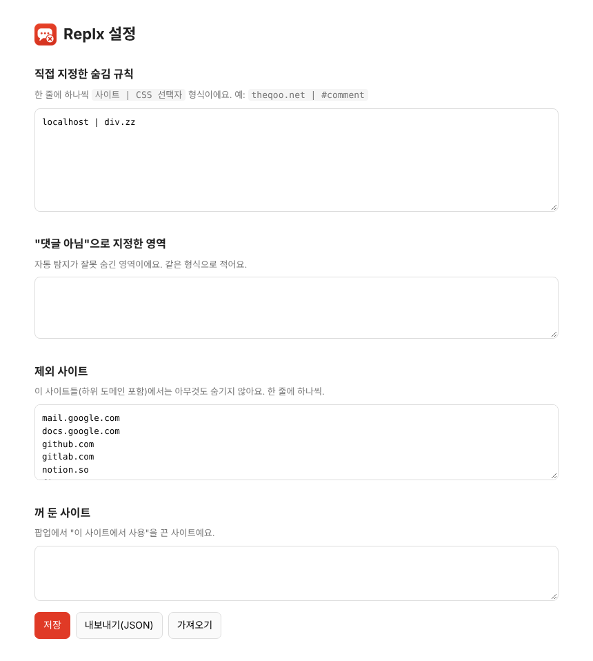

<p align="center">
  
</p>

<h1 align="center">Replx</h1>

<p align="center">
  커뮤니티·뉴스·유튜브의 댓글 영역을 숨겨 주는 크롬 확장 프로그램입니다.<br>
  자동으로 못 찾은 곳은 마우스로 클릭해서 직접 지정할 수 있어요.
</p>

<p align="center">
  <a href="https://github.com/ksthink/replx/actions/workflows/ci.yml"></a>
</p>

| 끄기 전 | 켠 후 |
|---|---|
|  |  |

---

## 목차
- [어떻게 숨기나요](#어떻게-숨기나요)
- [크롬에 설치하기](#크롬에-설치하기)
- [사용법](#사용법)
  - [팝업 메뉴](#팝업-메뉴)
  - [숨길 영역 직접 지정하기](#숨길-영역-직접-지정하기)
  - [접어두기 모드와 "여기는 댓글 아님"](#접어두기-모드와-여기는-댓글-아님)
  - [잠깐 보기](#잠깐-보기)
  - [전체 설정](#전체-설정)
  - [단축키](#단축키)
- [자주 묻는 질문](#자주-묻는-질문)
- [개발](#개발)
- [라이선스](#라이선스)

---

## 어떻게 숨기나요

Replx는 세 가지 방법을 겹쳐서 씁니다.

1. **기본 규칙**: 사이트별 CSS 선택자 133곳이 들어 있어요. 페이지가 그려지기 전에 CSS로 숨기기 때문에 댓글이 잠깐 보였다 사라지는 깜빡임이 없어요.
2. **자동 탐지**: 규칙이 없는 사이트에서는 페이지 구조를 읽어 댓글 영역을 찾아요. 판단은 모두 브라우저 안에서 하고, 페이지 내용을 밖으로 보내지 않아요.
3. **직접 지정**: 위의 두 방법으로 못 숨긴 영역은 사용자가 클릭해서 고르면 그 사이트의 규칙으로 저장돼요.

자동 탐지는 아래 신호에 점수를 매겨 **5점 이상**인 영역을 댓글로 판단해요.

| 신호 | 점수 |
|---|---|
| id·class·태그 이름에 `comment`, `cmt`, `reply`, `댓글`, `disqus`, `cbox` 등이 들어감 | +3 |
| "댓글 12", "Comments (3)" 같은 이름표가 있음 | +3 |
| "댓글을 입력하세요" 같은 입력창이 있음 | +3 |
| 작성자·시간·답글/추천 버튼을 가진 항목이 3개 이상 반복됨 | +4~5 |
| Disqus, giscus 같은 댓글 iframe이 있음 | +4 |
| 글 제목(h1)을 포함함, 메뉴(nav/header)임, 페이지 텍스트 대부분을 차지함 | −5~−6 |

본문까지 덮을 만큼 넓은 영역은 고르지 않아요. 기본 규칙이나 직접 지정이 이미 맞은 페이지에서는 잘못 숨기는 일을 막으려고 자동 탐지를 건너뛰어요.

---

## 크롬에 설치하기

아직 크롬 웹 스토어에는 올리지 않았어요. 아래 방법으로 직접 설치합니다. 엣지, 웨일, 브레이브 같은 크로미움 기반 브라우저에서도 같은 방법으로 설치할 수 있어요.

### 1단계. 확장 파일 받기

셋 중 편한 방법을 고르세요.

- **릴리스에서 받기(추천)**: [Releases](https://github.com/ksthink/replx/releases) 페이지에서 최신 `replx-v*.zip`을 내려받아 압축을 풉니다.
- **최신 빌드 받기**: [Actions → CI](https://github.com/ksthink/replx/actions/workflows/ci.yml)에서 가장 최근의 성공한 실행을 열고, 아래 **Artifacts**의 `replx-*`을 내려받아 압축을 풉니다. GitHub 로그인이 필요해요.
- **소스로 받기**:
  ```bash
  git clone https://github.com/ksthink/replx.git
  ```
  이 경우 저장소 안의 `extension` 폴더를 씁니다.

> 압축을 푼 폴더는 지우거나 옮기지 말고 그대로 두세요. 크롬이 그 폴더에서 확장을 계속 읽어요.

### 2단계. 개발자 모드 켜기

1. 크롬 주소창에 `chrome://extensions`를 입력합니다. 메뉴 **⋮ → 확장 프로그램 → 확장 프로그램 관리**로 들어가도 돼요.
2. 오른쪽 위의 **개발자 모드** 스위치를 켭니다.

### 3단계. 확장 불러오기

1. 왼쪽 위에 생긴 **압축해제된 확장 프로그램을 로드합니다** 버튼을 누릅니다.
2. 1단계에서 준비한 폴더를 고릅니다. 안에 `manifest.json`이 바로 보이는 폴더여야 해요.
   - zip을 받았다면 압축을 푼 폴더
   - 소스로 받았다면 `replx/extension` 폴더
3. 목록에 **Replx** 카드가 나타나면 설치가 끝난 거예요.

### 4단계. 툴바에 고정하기

1. 주소창 오른쪽의 퍼즐 조각(🧩) 아이콘을 누릅니다.
2. **Replx** 옆의 핀(📌)을 눌러 툴바에 고정합니다.
3. 이미 열려 있던 탭은 **새로고침**해야 적용돼요.

### 업데이트와 삭제

- **업데이트**: 새 버전 파일로 폴더를 덮어쓴 뒤 `chrome://extensions`에서 Replx 카드의 새로고침(⟳) 버튼을 누릅니다. 직접 지정한 규칙과 설정은 그대로 남아요.
- **삭제**: `chrome://extensions`에서 Replx 카드의 **삭제**를 누릅니다.

> 크롬을 켤 때 "개발자 모드 확장 프로그램을 사용 중지하세요"라는 안내가 뜰 수 있어요. 직접 설치한 확장에는 항상 뜨는 안내라서 **닫기**를 누르면 돼요.

---

## 사용법

### 팝업 메뉴



툴바의 Replx 아이콘을 누르면 열려요. 아이콘의 빨간 숫자는 지금 페이지에서 숨긴 댓글 영역의 개수예요.

- **맨 위 스위치**: 모든 사이트에서 켜고 끕니다.
- **현재 사이트 정보**: 숨긴 영역 개수와 방식(기본 규칙, 자동 탐지, 직접 지정)을 보여 줘요.
- **이 사이트에서 사용**: 지금 사이트에서만 켜고 끕니다.
- **잠깐 보기**: 숨긴 댓글을 잠시 보여 줘요.
- **＋ 직접 지정**: 숨길 영역을 클릭해서 고릅니다.
- **직접 지정 규칙 목록**: 이 사이트에 저장한 규칙이 나오고, ✕로 지울 수 있어요.
- **숨김 방식**: 완전히 숨김 또는 접어두기
- **댓글 영역 자동 탐지**: 끄면 기본 규칙과 직접 지정만 써요.
- **댓글 수 숫자도 숨기기**: 글 목록의 `[23]` 같은 댓글 수 표시를 숨겨요.

<br clear="right">

### 숨길 영역 직접 지정하기

자동으로 못 숨긴 댓글이 있을 때 씁니다.

**1. 시작하기**: 다음 셋 중 하나로 시작해요.
- 팝업에서 **＋ 직접 지정**을 누르기
- 단축키 `Alt+Shift+X`
- 댓글 위에서 마우스 오른쪽 버튼 → **Replx: 이 부분 숨기기 지정**. 이렇게 시작하면 클릭한 곳이 바로 선택돼요.

**2. 영역 고르기**: 마우스를 올리면 그 요소가 빨간 상자로 표시돼요. 숨길 댓글 영역을 클릭합니다. 이 동안에는 페이지의 링크나 버튼을 눌러도 동작하지 않아요.



**3. 범위 조절하고 저장하기**: 확인 창이 뜨면 아래처럼 조절해요.
- 댓글 하나만 잡혔다면 **↑ 더 넓게**(또는 키보드 `↑`)를 눌러 댓글 전체를 감싸는 영역까지 넓혀요.
- 너무 넓게 잡혔다면 **↓ 좁게**(`↓`)를 눌러요.
- 같은 선택자에 걸리는 다른 영역은 점선으로 함께 표시돼요.
- 원하는 범위가 되면 **이 사이트에서 숨기기**(`Enter`)를 눌러요. 취소는 `Esc`예요.



**4. 결과**: 저장한 선택자는 그 사이트(도메인)의 다른 글에도 계속 적용돼요.



> **팁**: 댓글 한 줄이 아니라 댓글 목록 전체를 감싸는 영역을 고르는 게 좋아요. 글마다 댓글 수가 달라도 같은 규칙으로 숨겨져요.

### 접어두기 모드와 "여기는 댓글 아님"

팝업에서 **숨김 방식 → 접어두기**를 고르면, 댓글을 완전히 없애는 대신 그 자리에 안내 줄을 남겨요.



- **보기 / 다시 숨기기**: 그 영역만 펼치거나 다시 접어요.
- **여기는 댓글 아님**: 자동 탐지가 댓글이 아닌 곳을 잘못 숨겼을 때 눌러요. 그 영역은 다음부터 숨기지 않아요. 자동 탐지로 숨긴 영역에만 나타나는 버튼이에요.

### 잠깐 보기

팝업의 **잠깐 보기**나 `Alt+Shift+C`를 누르면 현재 탭의 숨긴 댓글이 모두 나타나요. 한 번 더 누르면 다시 숨겨요. 이 상태는 저장되지 않아서 새로고침하면 다시 숨겨진 상태로 돌아와요.

### 전체 설정

팝업 아래의 **전체 설정**을 누르거나, `chrome://extensions`에서 Replx 카드의 **세부정보 → 확장 프로그램 옵션**으로 들어가요.



- **직접 지정한 숨김 규칙**: `사이트 | CSS 선택자` 형식으로 한 줄에 하나씩 적어요. 예: `theqoo.net | #comment`. CSS 선택자를 알면 직접 써 넣어도 돼요.
- **"댓글 아님"으로 지정한 영역**: 같은 형식이에요.
- **제외 사이트**: 여기 적힌 사이트(하위 도메인 포함)에서는 아무것도 숨기지 않아요. Gmail, Google Docs, GitHub, Notion 등이 기본으로 들어 있어요.
- **꺼 둔 사이트**: 팝업에서 "이 사이트에서 사용"을 끈 사이트 목록이에요.
- **내보내기/가져오기**: 설정 전체를 JSON 파일로 백업하거나 다른 컴퓨터로 옮길 수 있어요.

설정은 크롬 동기화 저장소에 저장돼요. 같은 구글 계정으로 로그인한 다른 컴퓨터의 크롬에도 Replx를 설치하면 설정이 따라와요.

### 단축키

| 동작 | 기본 단축키 |
|---|---|
| 잠깐 보기 / 다시 숨기기 | `Alt+Shift+C` |
| 숨길 영역 직접 지정 | `Alt+Shift+X` |
| (직접 지정 중) 범위 넓히기 / 좁히기 | `↑` / `↓` |
| (직접 지정 중) 저장 / 취소 | `Enter` / `Esc` |

단축키는 `chrome://extensions/shortcuts`에서 바꿀 수 있어요.

---

## 자주 묻는 질문

**설치했는데 댓글이 그대로 보여요.**
설치 전에 열려 있던 탭은 새로고침해야 적용돼요. 새로고침해도 그대로라면 **＋ 직접 지정**으로 댓글 영역을 한 번 지정해 주세요.

**댓글이 아닌 부분까지 사라졌어요.**
- 접어두기 모드라면 안내 줄의 **여기는 댓글 아님**을 누르세요.
- 직접 지정한 규칙 때문이라면 팝업의 규칙 목록에서 ✕로 지우세요.
- 그래도 안 되면 팝업에서 **이 사이트에서 사용**을 끄면 돼요.

**네이버 카페처럼 iframe 안에 있는 댓글도 되나요?**
네, 모든 프레임에서 동작해요. 직접 지정도 iframe 안의 요소를 그대로 클릭하면 돼요.

**페이지 내용이 어디로 전송되나요?**
아니요. 판단은 모두 브라우저 안에서 하고 외부 서버와 통신하지 않아요. 저장되는 건 설정과 직접 지정한 선택자뿐이에요.

**어떤 권한을 쓰나요?**
- `storage`: 설정 저장
- `contextMenus`: 우클릭 메뉴
- `activeTab`: 팝업에서 현재 탭 확인
- 모든 http/https 페이지의 콘텐츠 스크립트: 댓글을 숨기는 데 필요

---

## 개발

```
extension/              크롬에 불러오는 확장 본체
  manifest.json
  src/defaults.js       기본 설정
  src/rules.js          사이트 규칙 (자동 생성)
  src/detector.js       자동 탐지 엔진
  src/picker.js         직접 지정(요소 선택기)
  src/content.js        페이지 처리: CSS 주입, 표시, 접기, 메시지
  src/background.js     배지, 단축키, 우클릭 메뉴
  popup/  options/      팝업과 설정 화면
  data/                 규칙 원본 (upstream-sites.json, kr-sites.json)
tools/build-rules.mjs   data/*.json → src/rules.js
tests/                  E2E 테스트, 스크린샷 스크립트, 테스트용 페이지
docs/screenshots/       README 스크린샷 (Actions가 자동 갱신)
```

### 사이트 규칙 추가

`extension/data/kr-sites.json`을 고친 뒤 규칙 파일을 다시 만듭니다.

```bash
node tools/build-rules.mjs
```

### 테스트와 스크린샷

```bash
pip install playwright
python -m playwright install chromium
python tests/e2e.py          # 확장을 크롬에 올려 탐지·직접 지정·접기 동작 검증
python tests/screenshots.py  # docs/screenshots 다시 생성
```

### GitHub Actions

| 워크플로 | 언제 | 하는 일 |
|---|---|---|
| **CI** | main 푸시, PR | 규칙 파일 최신 여부·문법 검사 → E2E 테스트 → 확장 폴더를 아티팩트로 업로드 |
| **Screenshots** | `extension/`, `tests/` 변경 푸시, 수동 실행 | 스크린샷을 다시 찍고, 바뀌었으면 자동으로 커밋 |
| **Release** | `v*` 태그 푸시 | manifest 버전 확인 → zip을 만들어 GitHub 릴리스에 업로드 |

새 버전을 배포하려면 `extension/manifest.json`의 `version`을 올리고 같은 버전의 태그를 푸시합니다.

```bash
git tag v0.1.0
git push origin v0.1.0
```

---

## 라이선스

MIT. 사이트 규칙 일부는 [grantwinney/hide-comments-everywhere](https://github.com/grantwinney/hide-comments-everywhere)(MIT, `extension/data/UPSTREAM_LICENSE`)에서 가져왔어요.
